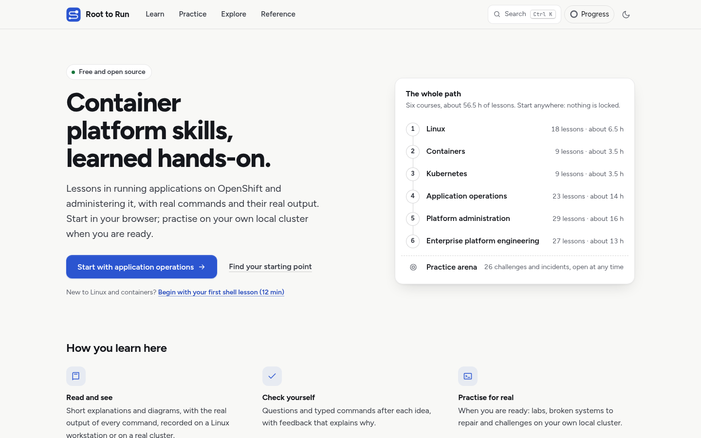
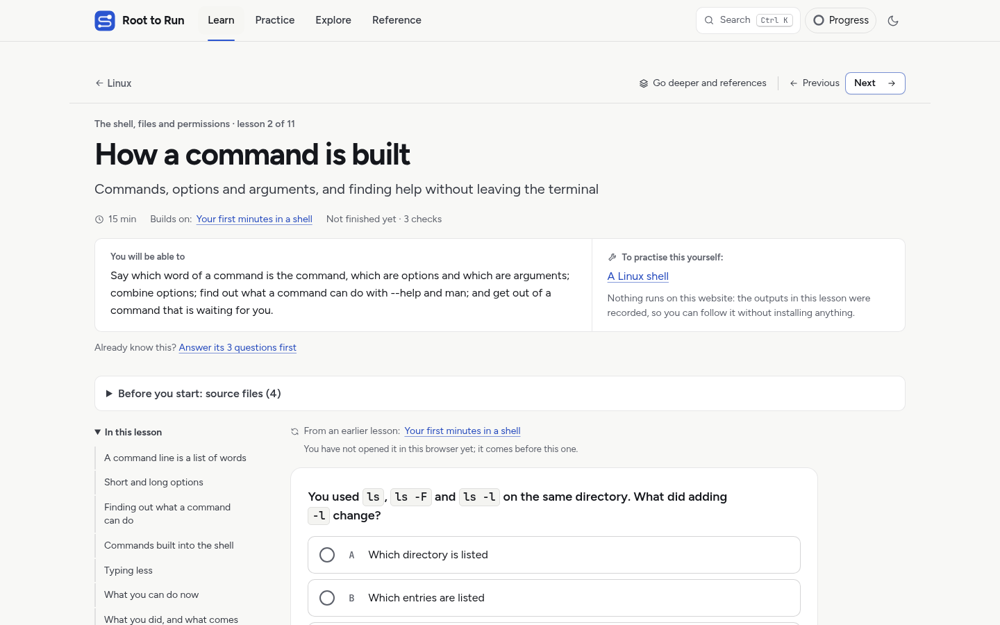
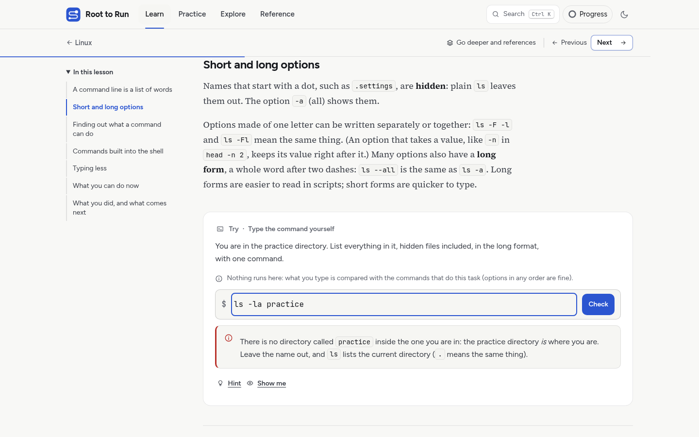
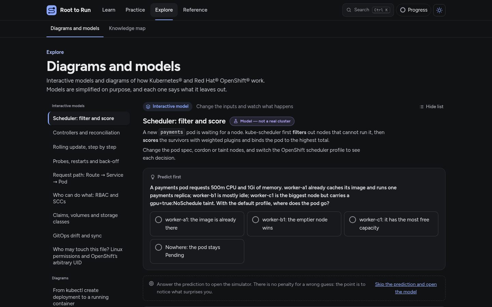
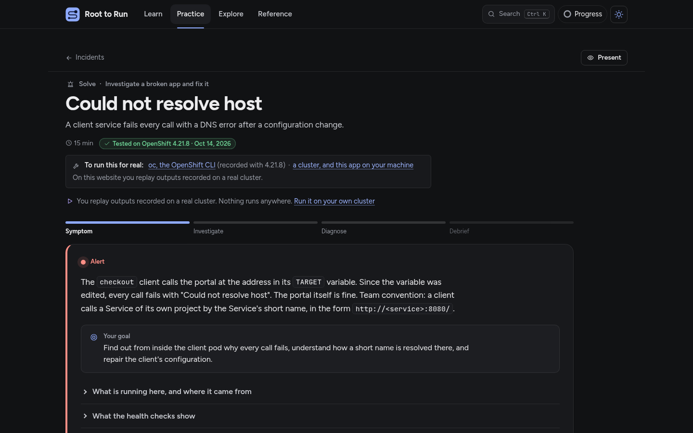

# Root to Run

**Understand the systems. Practise running them.** A free, open-source learning environment for Linux, containers,
Kubernetes and Red Hat® OpenShift®, taught as one path and built on real commands, real outputs and real incidents.
It runs in your browser with no account and no cluster; when you are ready, you can connect your own OpenShift Local.

**▶ Try it live: [roottorun.aminelg.com](https://roottorun.aminelg.com)**, the whole course in your browser, with no
account and nothing to install. Or run it on your own machine: [Getting started](#getting-started).

https://github.com/user-attachments/assets/420958eb-f124-4dee-9394-475944417812

## What learning here looks like

- **One path, six courses**: Linux → Containers → Kubernetes → OpenShift applications → OpenShift administration →
  Enterprise platform engineering (115 lessons), plus a practice arena open at any time. Nothing is locked: pick a
  route ("I know Kubernetes, show me what the platform adds") or take a short diagnostic to find your gaps.
- **Lessons you work through, not just read.** Each lesson is one page that teaches one idea at a time, with
  questions that explain every answer, typed command tasks checked against commands that really work (nothing you type
  is run), ordering tasks, and diagrams you can explore part by part.
- **Real outputs.** Commands in lessons are recordings: Linux and Podman on RHEL 9, OpenShift on OpenShift Local 4.21
  as an ordinary user and, for administration, as cluster administrator on a disposable cluster. Anything not run is
  labelled as a documented example, and every lesson lists its references to the official documentation.
- **Interactive models**: change an input and watch cause and effect, for example a rolling update, readiness and
  liveness probes, the scheduler, RBAC, storage claims, GitOps drift and Linux permissions.
- **Practice**: 27 guided labs and 16 incidents replayed from a real cluster (find the cause from the evidence, then
  compare with the root cause), and 10 challenges graded against the end state of your own cluster.
- **Review and progress**: questions come back when they are due and you grade your own recall. Progress keeps the
  evidence apart (read, answered, practised, verified on a cluster) and stays in your browser; export it at any time.



| A lesson | A typed task | An interactive model | An incident |
|---|---|---|---|
|  |  |  |  |

## Getting started

The quickest way is the live site: [roottorun.aminelg.com](https://roottorun.aminelg.com). To run it yourself, you need Python 3.12 with [uv](https://docs.astral.sh/uv/) and Node.js 22.12 or newer.

```bash
ACADEMY_CLUSTER=off ./run.sh   # http://127.0.0.1:8768: the whole course with recorded outputs, no cluster
./run.sh                       # the same, and live labs if `oc` and a cluster are available
./stop.sh
```

The first run creates `.venv` and builds the frontend. On Windows, use PowerShell and `scripts\serve.py` instead:
[docs/WINDOWS.md](docs/WINDOWS.md). To publish the course as a static site, run it in a container, host it on
Kubernetes or OpenShift, or set up live labs: [docs/INSTALL.md](docs/INSTALL.md).

### Live labs, safely

A connected cluster stays **read-only** until you approve it for training by typing its API host. The approval is
bound to that cluster's API address and certificate authority. Before a lab runs, a preflight checks what it needs
against what your identity can actually do. Everything a lab creates is recorded with its UID, and cleanup deletes only
those exact objects, then confirms with the API server that they are gone; if something is stuck, Root to Run says
what and why and never forces it. Use a disposable cluster such as OpenShift Local, never production.

## Local development

```bash
uv venv .venv --python 3.12 && uv pip install --python .venv/bin/python -r requirements-dev.txt
cd frontend && npm ci && npm run build && cd ..
ACADEMY_CLUSTER=off ./run.sh                              # API and site on http://127.0.0.1:8768
cd frontend && npm run dev                                # hot reload, proxies /api and /data to 8768
```

The stack: React and TypeScript in `frontend/`, FastAPI in `backend/`, course content as YAML in `content/en/`
(format: [docs/AUTHORING.md](docs/AUTHORING.md)), recorded outputs in `content/recordings/`. The checks to run before a
pull request are in [CONTRIBUTING.md](CONTRIBUTING.md).

## Contributing

Corrections, better explanations, new exercises and code are welcome, and most content changes need no cluster.
On the published site, every lesson has *Report a problem* and *Edit this lesson* links (a build without a
repository address hides them). [CONTRIBUTING.md](CONTRIBUTING.md) lists the requirements: technically verifiable
content, original work only, and tests for what you change. Security issues: [SECURITY.md](SECURITY.md).

## Licences

© 2026 Amine-LG and contributors.

- **Code**: Apache License 2.0 ([LICENSE](LICENSE), [NOTICE](NOTICE)).
- **Original course content**: CC BY-SA 4.0 ([content/LICENSE.md](content/LICENSE.md)).
- **Third-party material**: components and fonts, examples adapted from other documentation
  ([content/ATTRIBUTIONS.md](content/ATTRIBUTIONS.md)), third-party program output in the recordings, and the
  screenshots of the OpenShift web console (with the Red Hat and OpenShift marks they show) keep their owners' terms
  and are not relicensed by the project ([THIRD_PARTY_NOTICES.md](THIRD_PARTY_NOTICES.md)). The built site ships every
  licence text in `licenses.txt`.

You may use, change and host your own version, also under another name, within those licences.

## Independence and trademarks

Root to Run is an independent project, not affiliated with, sponsored or endorsed by Red Hat, LLC, The Linux
Foundation or the CNCF. It is not official training or a certification course and contains no exam content. The
lessons are the project's own work, written with AI assistance from the public documentation and tested on real
systems; they do not reproduce Red Hat training courses. Red Hat and OpenShift are trademarks of Red Hat, LLC,
registered in the United States and other countries; Kubernetes® is a registered trademark of The Linux Foundation.
These names are used only to identify the technologies taught.

Root to Run is created and maintained by [Amine-LG](https://github.com/Amine-LG), with AI-assisted development using
models from Anthropic and OpenAI (who do not own, sponsor or endorse the project), and with contributions from the
community.
